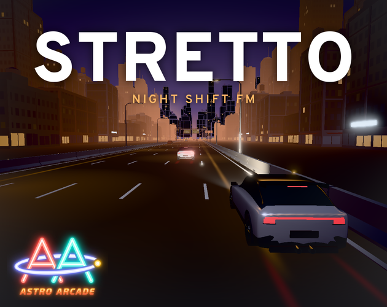
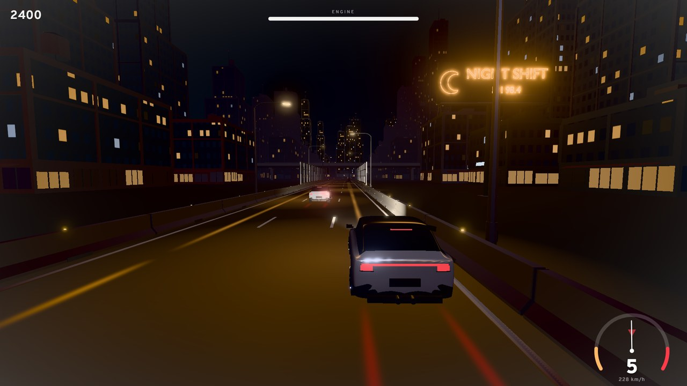
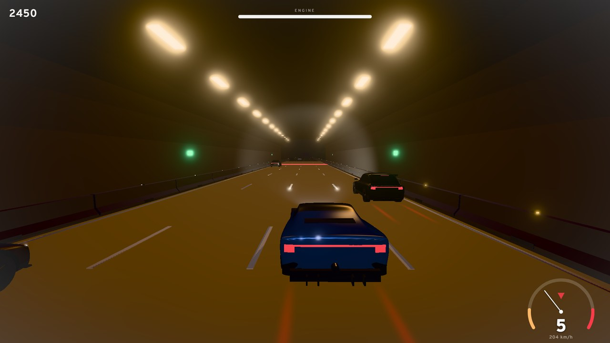
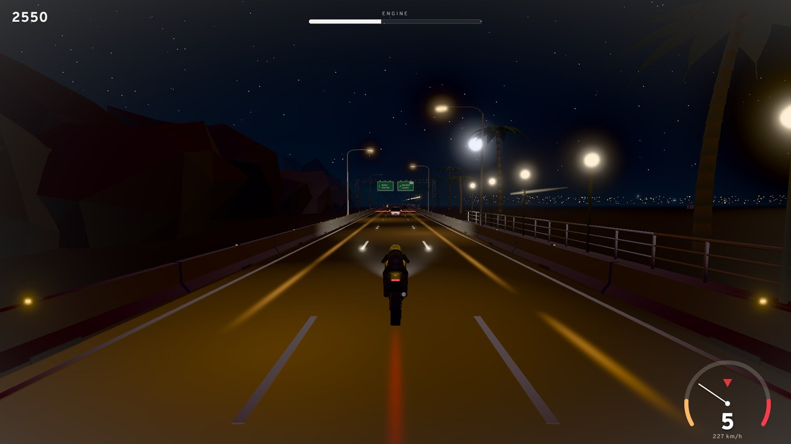

# Stretto



**Shift gears to the beat.** Stretto is a rhythm driving game made for
[GitHub Game Off 2026](https://itch.io/jam/game-off-2026), whose theme is **SHIFT**.

You drive through the night while Vela hosts *Night Shift FM*, a late-night radio show. Every
gear change is a note: blue lines on the road ask you to shift up, red lines to shift down, and
you have to do it right as you cross them, on the beat of the song.

**Play it in your browser:** [armaisdiaz.itch.io/stretto](https://armaisdiaz.itch.io/stretto)



## How to play

- **Blue line:** shift up as you cross it.
- **Red line:** shift down.
- **Traffic:** change lanes to dodge it.
- **Streak:** every 5 good shifts in a row raise the multiplier, up to ×4. A mistake resets it.
- **Pickups:** nitro, repair, extra points and a multiplier step. Nitro lasts until the next
  line, and that shift is worth double.

Shifting late or early grinds the gears, missing a line over-revs or lugs the engine, and
crashing hurts it even more. Perfect shifts patch it up a little. If the engine gives out, you
stall. The timing window gets tighter with every gear.

| Action | Keyboard | Gamepad |
|---|---|---|
| Shift up | Right Shift, ↑ or W | Right bumper or trigger |
| Shift down | Left Shift, ↓ or S | Left bumper or trigger |
| Change lane | ← → or A D | D-pad or left stick |
| Pause | Esc or P | Start |
| Restart | R | |
| Menus | Arrows, Enter, Esc | D-pad, A, B |

## What's in it

- **Five levels, five stations:** leaving downtown (synth-pop, 100 BPM), the coast road
  (nu-disco, 115), the desert (progressive house, 124), mountain tunnels (techno, 132) and the
  highway at dawn (drum and bass, 172).
- **Endless mode:** all five stations non-stop. Every lap around the dial brings tighter timing
  and more traffic.
- **Four vehicles**, unlocked as you clear levels, each with its own engine sound: a tuned
  hatchback, a muscle car, a motorbike and a wedge supercar.
- Three difficulty levels, latency calibration, local high scores and seven languages
  (English, Spanish, German, Portuguese, Russian, Simplified Chinese and Japanese).



## Building

You need [Node.js](https://nodejs.org/) 20.19 or newer.

```sh
npm install
npm run dev      # development server
npm run build    # production build in dist/
```

The build uses relative paths, so `dist/` can be served from any folder (itch.io serves it from
a subfolder).

## Project layout

| Folder | What it holds |
|---|---|
| `src/` | The game, in TypeScript with [three.js](https://threejs.org/) |
| `public/` | 3D models, music stems and sound effects loaded at runtime |
| `tools/blender/` | Scripts that build the vehicles and the scenery in Blender (sources in `assets/blender/`) |
| `tools/sonicpi/` | The songs and sound effects, written for [Sonic Pi](https://sonic-pi.net/), and the script that records them into stems |
| `firestore.rules` | Security rules of the online ranking (Cloud Firestore): anyone can read it, scores can only be added in the right format and never changed |



## Credits

Made by **Astro Arcade**.

- [three.js](https://threejs.org/) (MIT license).
- [Firebase](https://firebase.google.com/) JavaScript SDK, for the online ranking (Apache License 2.0).
- [Overpass](https://overpassfont.org/) font (SIL Open Font License 1.1, see `src/fonts/OFL.txt`).
